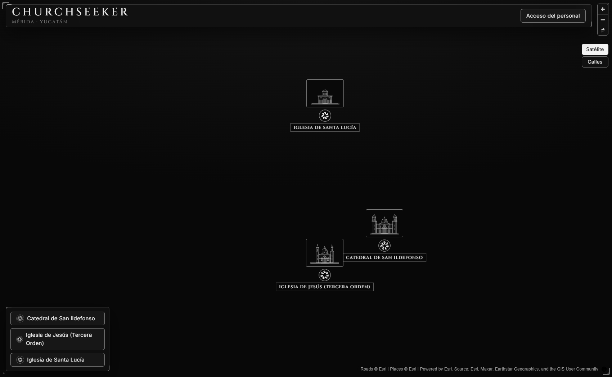
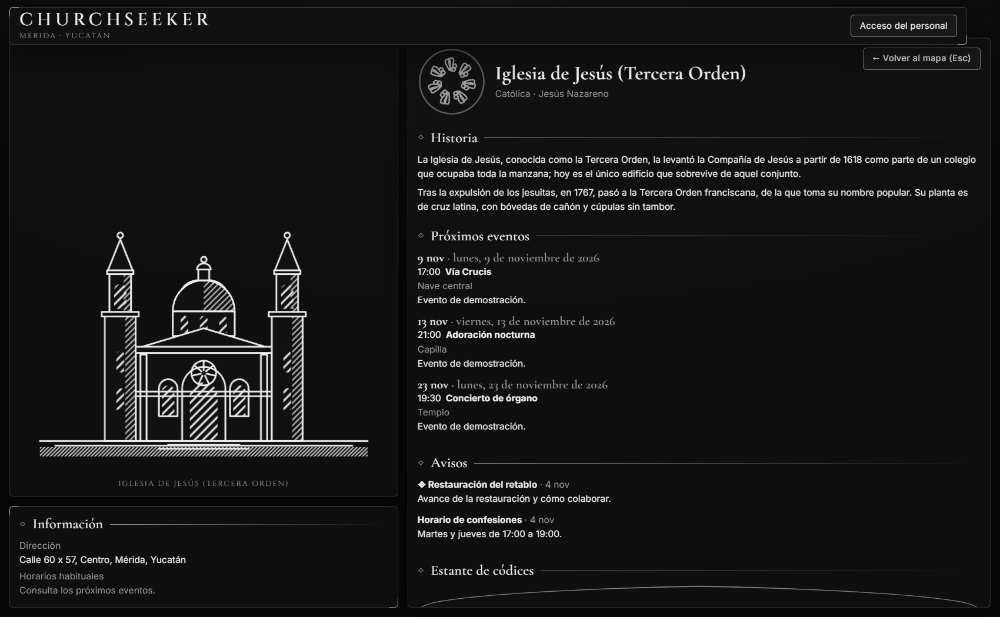
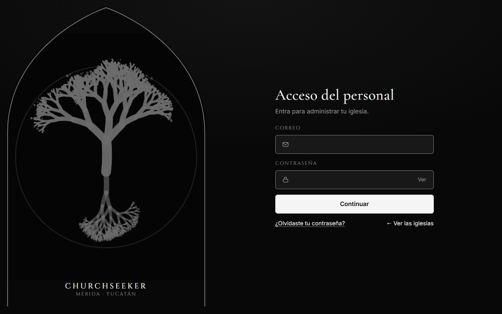
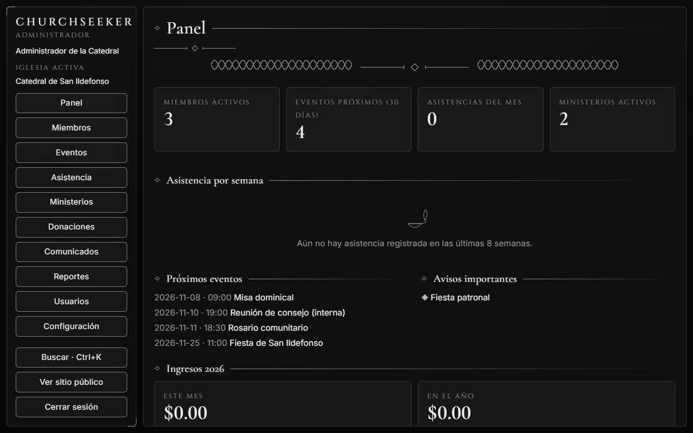
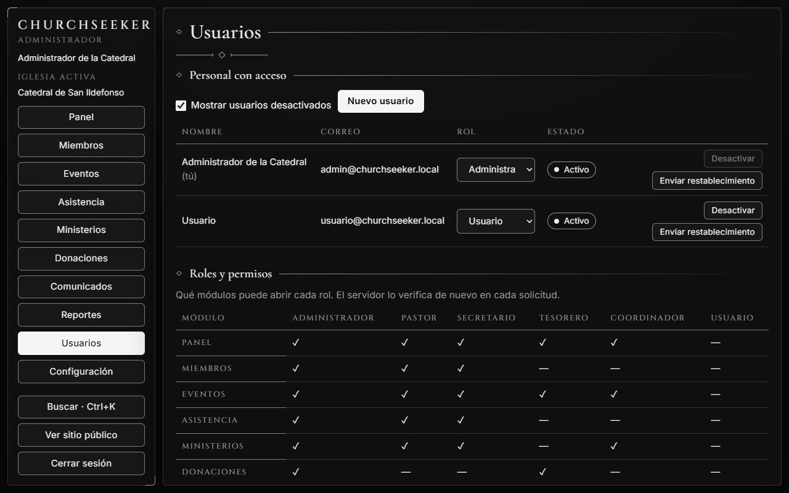
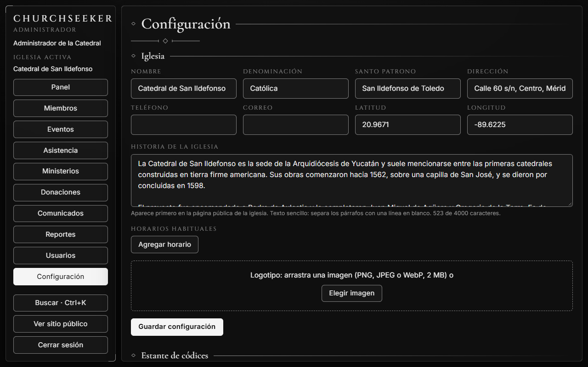
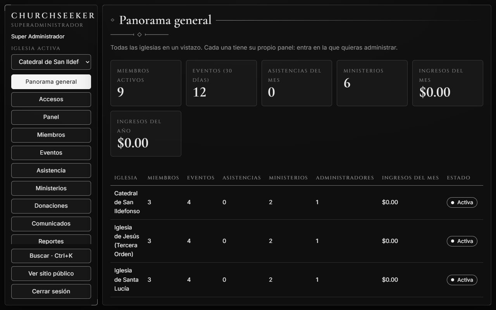
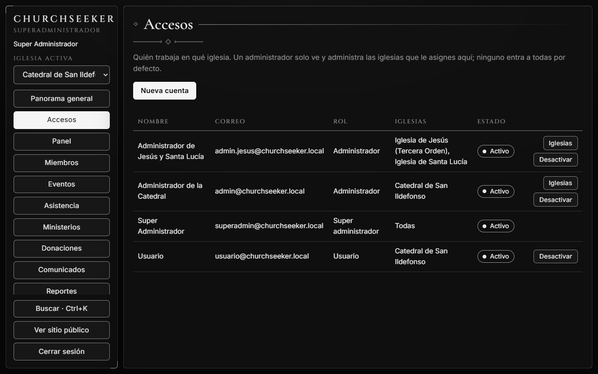
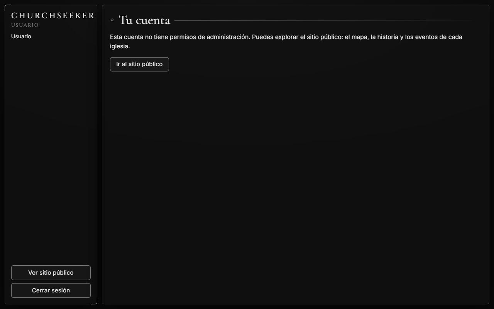

# ChurchSeeker

Plataforma web para las iglesias de Mérida, Yucatán: una experiencia pública con un mapa de las iglesias y, de cada una, su historia, su grabado, sus eventos, avisos y un estante de libros en 3D, y un panel de administración eclesiástica (miembros, eventos, asistencia, ministerios, donaciones, comunicados, reportes y configuración) con control de acceso por roles **y por iglesia**.

El plan maestro y la bitácora de avance están en [`implementationplan.md`](implementationplan.md); el diseño visual, en [`DESIGN.md`](DESIGN.md).

## Estructura

| Carpeta | Contenido |
| --- | --- |
| `Backend/` | Solución .NET 8: `Domain`, `Application`, `Infrastructure`, `WebAPI` y dos proyectos de pruebas (`UnitTests`, `BreakTests`). |
| `Frontend/` | React + TypeScript + Vite, MapLibre, Asciify, SVG propio para los grabados, Three.js (solo el estante de libros) y react-pdf. Pruebas con Vitest y Playwright. |
| `docs/screenshots/` | Capturas de este README (se regeneran con `Frontend/e2e/shots/readme-shots.mjs`). |

## Requisitos

.NET SDK 8 o superior, Node.js 20 o superior y Microsoft Edge (lo usa Playwright; no se descarga ningún navegador). Docker es opcional: levanta PostgreSQL y un buzón de correo de pruebas.

## Ejecutar en desarrollo

```bash
# API (http://localhost:5054). Crea la base SQLite, los datos de demostración y las cuentas de demostración (ver abajo).
dotnet run --project Backend/src/ChurchSeeker.WebAPI --launch-profile http

# Frontend (http://localhost:5173, con proxy a la API)
cd Frontend && npm install && npm run dev
```

- Público: `http://localhost:5173/` (mapa, iglesias, estante de códices).
- Personal: `http://localhost:5173/#/login`.
- `appsettings.Development.json` activa `Seed:Demo`: 3 iglesias con historia, eventos, avisos, ministerios y libros PDF de muestra, **y las cuentas de demostración** de la sección siguiente. Solo en desarrollo: la API se niega a arrancar si `Seed:Demo` está activo en cualquier otro entorno.
- Una base SQLite creada por una versión anterior se actualiza sola al arrancar (tablas y columnas nuevas); PostgreSQL usa migraciones.

## Cuentas de demostración

Existen **solo en una base de datos de desarrollo** (las crea el arranque en el entorno `Development`). Sus contraseñas son públicas, porque están aquí: no uses estas cuentas ni estas contraseñas en ningún despliegue real.

| Cuenta | Correo | Contraseña | Qué puede hacer |
| --- | --- | --- | --- |
| **Super administrador** (la plataforma) | `superadmin@churchseeker.local` | `Super!Plataforma2026#` | Entra al panel de **todas** las iglesias, ve el **Panorama general** de todas juntas y decide qué administrador trabaja en qué iglesia. |
| **Administrador de una iglesia** | `admin@churchseeker.local` | `Adm1n!Passw0rd#` | Administra **solo la Catedral de San Ildefonso**. No ve las demás iglesias ni el área de la plataforma. |
| **Administrador de dos iglesias** | `admin.jesus@churchseeker.local` | `Adm1n!Jesus2026#` | Administra **Iglesia de Jesús** e **Iglesia de Santa Lucía**, y elige con un selector en cuál trabaja. |
| **Usuario normal** | `usuario@churchseeker.local` | `Usu4rio!Normal2026#` | Cuenta sin permisos de administración: inicia sesión pero no ve ningún módulo. |

En un despliegue real la cuenta de la plataforma no se publica: se crea al arrancar desde secretos del entorno con `Seed:SuperEmail` y `Seed:SuperPassword` (y, opcionalmente, `Seed:SuperChurchId`). El primer administrador de una iglesia puede sembrarse igual con `Seed:AdminEmail`, `Seed:AdminPassword` y `Seed:AdminChurchId`.

## Cómo funcionan los permisos

- **Cada administrador solo ve las iglesias que se le asignan.** Una cuenta trabaja en una o más iglesias, elegidas expresamente: ningún administrador entra a todas por defecto, y el panel de cada administrador es el de la **iglesia activa**. El token lleva esa iglesia y el servidor comprueba en cada solicitud que la cuenta siga teniendo acceso: quitar un acceso termina esa sesión de inmediato.
- **Solo la plataforma (super administrador) concede accesos**, y solo a administradores. Un administrador de iglesia nunca puede crear ni ascender a un super administrador, ni ver o cambiar su cuenta, ni cambiar una cuenta que trabaja en varias iglesias (queda en solo lectura y la gestiona la plataforma).
- **Roles:** Administrador, Pastor, Secretario, Tesorero, Coordinador (cada uno con sus módulos; la matriz está en **Usuarios**), **Super administrador** (todas las iglesias, actuando como administrador dentro de la activa, más el Panorama general y los Accesos) y **Usuario** (cuenta sin permisos de administración).
- El servidor lo verifica de nuevo en cada solicitud; la interfaz solo oculta lo que no corresponde.

## Recorrido por la aplicación

### Mapa público



El mapa de Mérida muestra cada iglesia con su insignia (un sigilo propio generado a partir de su nombre), su nombre y, al acercarse, su **grabado**. Se puede pasar el ratón por encima y hacer clic en una iglesia, o elegirla en la lista de la esquina (la lista funciona también con teclado y lector de pantalla). Con imágenes satelitales o con el mapa de calles.

### Página de una iglesia: Historia primero



Al elegir una iglesia se abre su página: el **grabado** de su fachada (dibujado a mano para las tres iglesias piloto y por tipologías para las demás), su **Historia** como primera sección, la información de contacto y horarios, los próximos eventos, los avisos y el estante de libros. Sin necesidad de iniciar sesión.

### Inicio de sesión



Acceso del personal con correo y contraseña. Tras cinco intentos fallidos la cuenta se bloquea unos minutos, y la pantalla da siempre la misma respuesta para no revelar qué correos existen. Cada cuenta entra al panel que le corresponde.

### Panel del administrador de una iglesia



El **panel** resume la iglesia activa: miembros activos, eventos de los próximos 30 días, asistencias del mes, ministerios, asistencia por semana, próximos eventos, avisos importantes y los ingresos del año (solo para Administrador y Tesorero). El menú de la izquierda muestra solo los módulos que permite el rol.

### Usuarios y roles



El administrador crea cuentas de su iglesia, cambia roles, desactiva o reactiva usuarios y envía correos de restablecimiento. Nunca puede dejar a la iglesia sin un administrador activo ni cambiarse el rol a sí mismo. Más abajo, la matriz de roles y permisos.

### Configuración e Historia de la iglesia



En **Configuración** el administrador edita el perfil de su iglesia (nombre, dirección, contacto, coordenadas, horarios, logotipo) y escribe su **Historia**: texto sencillo, hasta 4000 caracteres, con los párrafos separados por una línea en blanco. Es lo primero que ven los visitantes en la página pública de la iglesia.

### Un administrador de varias iglesias


Quien trabaja en más de una iglesia ve un selector de **Iglesia activa** en el menú. Al cambiar, el servidor emite un token para esa iglesia y todos los módulos (panel, miembros, eventos, donaciones…) pasan a mostrar los datos de la nueva iglesia, y solo los suyos.

### Panorama general (solo la plataforma)



El super administrador ve el **Panorama general**: los totales de todas las iglesias y una fila por iglesia (miembros, eventos, asistencias, ministerios, administradores e ingresos del mes). Con **Entrar** pasa al panel propio de cualquiera de ellas.

### Accesos (solo la plataforma)



En **Accesos** la plataforma decide **quién trabaja en qué iglesia**: ve todas las cuentas con sus iglesias, asigna una o varias iglesias a los administradores (los demás roles trabajan en una sola), crea cuentas nuevas y activa o desactiva cuentas. El servidor impide dejar una iglesia sin administrador activo.

### Cuenta sin permisos



Un **Usuario** normal inicia sesión pero no ve ningún módulo: solo un aviso de que su cuenta no tiene permisos de administración y un enlace al sitio público. El servidor responde 403 a cualquier endpoint de personal (una prueba recorre todos para comprobarlo).

## PostgreSQL y correo con Docker

Copia `.env.example` a `.env` (solo valores de desarrollo) y ejecuta:

```bash
docker compose up -d      # PostgreSQL 16 en localhost:5433 y Mailpit (buzón de pruebas) en http://localhost:8025
```

Luego arranca la API con el proveedor PostgreSQL. Las migraciones EF se aplican solas al iniciar (`Database:Migrate`):

```bash
Database__Provider=Postgres \
ConnectionStrings__Default='Host=localhost;Port=5433;Database=churchseeker;Username=churchseeker;Password=churchseeker_dev' \
Email__Host=localhost Email__Port=1025 Email__ResetBaseUrl=http://localhost:5173 \
dotnet run --project Backend/src/ChurchSeeker.WebAPI --launch-profile http
```

Sin `Email:Host` el correo solo se registra en el log. Con `Email:Host` se envía por SMTP (MailKit); en producción define `Email:UseSsl`, `Email:User`, `Email:Password` y `Email:From` con secretos del entorno, nunca en el repositorio. Para crear una migración nueva: `dotnet tool restore` y `dotnet ef migrations add <Nombre> --project src/ChurchSeeker.Infrastructure --startup-project src/ChurchSeeker.Infrastructure --output-dir Migrations` (con `CHURCHSEEKER_DESIGN_CS` apuntando a la base).

## Pruebas

```bash
cd Backend && dotnet test              # UnitTests + BreakTests (pruebas destructivas), en SQLite
CHURCHSEEKER_TEST_PG='Host=localhost;Port=5433;Username=churchseeker;Password=churchseeker_dev' dotnet test   # las mismas pruebas, cada fábrica con su base PostgreSQL desechable
cd Frontend && npm test                # Vitest
cd Frontend && npm run e2e             # Playwright (levanta la API y el build; usa Edge)
```

Las pruebas e2e de acceso usan las cuentas de demostración de arriba, así que necesitan la API en desarrollo (como la levanta Playwright).

## Seguridad (resumen)

- Contraseñas con política estricta, bloqueo tras 5 intentos, JWT de 15 minutos y refresh token rotativo y de un solo uso en cookie `HttpOnly; Secure; SameSite=Strict`; reutilizar un refresh revocado (o usarlo dos veces a la vez) cierra todas las sesiones.
- Aislamiento por iglesia con filtro global (un recurso de otra iglesia responde 404), acceso por iglesia comprobado en cada solicitud, roles verificados en el servidor, auditoría inmutable y borrado siempre lógico.
- Subida de archivos validada por contenido (firmas), con rechazo de PDF con scripts o archivos incrustados, nombres generados por el servidor y tamaños limitados.
- Rate limiting (login, calendario público, reportes), CORS estricto, cabeceras de seguridad y CSP en el build del frontend.
- El token de acceso vive solo en memoria; el frontend trata todo texto del servidor como texto (la Historia y todo contenido se muestran como texto, nunca como marcado).
- Las cuentas de demostración solo existen en desarrollo y la API no arranca con ellas activas fuera de él.

## Decisiones y límites conocidos

- **Base de datos:** SQLite por defecto en desarrollo (se actualiza sola); PostgreSQL con migraciones EF (`Database:Provider=Postgres`), probado con toda la suite. Falta un entorno de producción administrado (copias de seguridad, TLS hacia la base).
- **Usuarios:** cambiar el rol, quitar un acceso o desactivar a alguien invalida su sesión al instante. Nadie puede cambiarse a sí mismo y cada iglesia conserva siempre al menos un administrador activo. Los permisos por rol son fijos en el código; la matriz es de solo lectura.
- **Mapa:** MapLibre con mosaicos Esri (sin API key). Antes de producción hay que confirmar la licencia de esas imágenes o cambiar a otro proveedor: los marcadores de iglesias son HTML y no dependen de la base.
- **Grabados:** cada iglesia se muestra como un grabado de líneas SVG: tres láminas dibujadas a mano para las iglesias piloto y cuatro tipologías (nave, rotonda, pórtico, patio) variadas por id para las demás. Sin WebGL ni descargas. Los libros siguen siendo 3D.
- **Historia:** las de las tres iglesias piloto se basan en fuentes públicas (Wikipedia, INAH, guías turísticas) y dicen cuándo difieren; las de Jesús y Santa Lucía conviene revisarlas. Cada iglesia puede reescribir la suya.
- **Correo:** SMTP real con MailKit cuando `Email:Host` está definido; si no, solo se registra en el log. Falta elegir y probar un proveedor de producción.
- **PDF:** el escaneo busca contenido activo por bytes; no detecta el que esté dentro de flujos comprimidos.
- **QuestPDF** se usa con licencia Community.
- **Inicio de sesión:** correo y contraseña. No hay enlace por correo ni GitHub.
